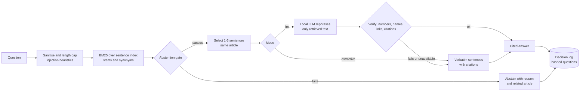

# Solution Design: Solstice Docs Q&A Assistant

## 1. Problem, in my words

Solstice admins keep asking the same support questions whose answers already exist in the docs. Elena wants a plain-English
question box that returns a real answer from those docs. Her one hard requirement is behavioural: **when the docs do not
cover something, say so instead of inventing an answer.**

So the product is not "answer questions". It is "answer only what the docs support, and be trustworthy about the rest".
A wrong answer costs more than a refusal: an admin may act on it, support loses trust in the tool, and Solstice owns the
mistake. I therefore weight **precision over recall** everywhere, and I measure it (section 5).

## 2. Assumptions (to confirm with Elena)

| # | Assumption | Question I would ask |
|---|---|---|
| A1 | The six supplied articles are the complete, trusted corpus (no user-generated or hostile content) | How many articles in production, who edits them, how often? |
| A2 | Users are authenticated admins asking single-turn English questions | Languages? Any anonymous or end-learner use? |
| A3 | A short cited excerpt is acceptable; fluent prose is nice to have | Does support want conversational tone or exact doc wording? |
| A4 | Plan-specific facts (Growth vs Enterprise) are all in the docs; no per-tenant data is needed | Should answers depend on the asking customer's plan? |
| A5 | Low volume, latency under a second, no budget for paid inference in v1 | Expected questions per day, and an acceptable cost per answer? |
| A6 | "I don't know" should still point somewhere useful | Is there a support handoff or ticket flow to link to? |

## 3. Approach

**Index (built once at start-up).** Each article is split into sentences, the unit of retrieval and citation (`D-03#5`).
Terms are lower-cased, lightly stemmed and mapped through a small synonym list kept in a data file. IDF is computed over
articles. A content fingerprint identifies the indexed corpus version.

**Retrieval.** BM25 over sentences, with a small bonus when a question term appears in the article title. I ranked
sentences, not whole articles, because that fixed two failures I measured in my first version: it returned the wrong
sentence of the right article, and it cut multi-step procedures to one line.

**Abstention gate** (first failing check wins, each with a reason code that is logged and shown):

1. *Unknown terms*: if a significant question word appears nowhere in the docs (Salesforce, Starter, Okta), do not answer.
   This catches "How do I reset my **Salesforce** password?" which a plain overlap score answers confidently and wrongly.
2. *Ambiguity*: two different articles match about equally well, so abstain.
3. *Weak match / low coverage*: the selected sentences must contain at least two question terms and cover most of the
   question's weighted terms.
4. *Too short*: a bare keyword such as "password" is too ambiguous to answer.

When it abstains it says why and, where possible, names the closest article, so "no" is still useful.

**Answer selection.** The best sentence, plus adjacent sentences that are nearly as relevant, plus a sentence that covers a
still-uncovered part of a multi-part question: at most three, all from one article, cited by passage ID.

**Optional LLM mode (`--mode llm`, local model via Ollama).** Retrieval and the gate always run first; the model is never
called for a question the gate rejected. It receives only the 1-3 retrieved sentences, delimited and labelled as untrusted
data, with a prompt that demands citations and the exact abstain sentence. Its output is then checked: every number, link,
capitalised name and citation must exist in the retrieved text, and unsupported words are capped. A failed check, a timeout
or an unreachable model falls back to the extractive answer. The model can only return text: no tools, no browsing, no files.
The prompt is a separate file ([prompts/grounded_answer.md](./prompts/grounded_answer.md)).

## 4. Trade-offs I considered

| Decision | Chosen | Alternative | Why |
|---|---|---|---|
| Answering | Extractive default, LLM optional | LLM always | Verbatim excerpts cannot hallucinate; no cost, keys or latency; the LLM adds fluency only where it can be verified |
| Retrieval | BM25 + synonyms | Embeddings / hybrid | Six short articles do not justify an embedding service; embeddings are the first upgrade for synonyms (section 6) |
| Unit | Sentence | Whole article or fixed-size chunks | The starter's fixed-size chunker drops the trailing partial chunk and splits mid-sentence, so facts like "capped at 10,000 rows" can be lost |
| Confidence | Layered gate with reasons | One similarity threshold | A single score cannot express "the topic matches but a key entity is missing", which is the dangerous case |
| Stemming | Tiny suffix rules + synonym data file | Hard-coded word fixes, NLP library | Keeps behaviour inspectable and editable by support staff without code changes |
| Dependencies | Standard library only | Libraries | Runs anywhere in one command; nothing to patch |

## 5. Evidence

I wrote a labelled set of 37 questions in seven categories (direct, paraphrase, multi-part, out-of-scope, near-miss,
adversarial, injection) and an evaluation harness (`eval/run_eval.py`). Results for the extractive mode:

| Measure | Result |
|---|---|
| Overall pass | 37 / 37 |
| False answers (unanswerable question answered) | 0 / 19 |
| Answer recall (answerable question answered correctly) | 18 / 18 |

These numbers are **optimistic**. My first version of the engine failed several of these cases (for example answering the
Salesforce-password question), and I tuned the gate and the synonym list against this same set. The set is small and written
by me. The right claim is "the design handles the failure modes I could think of", not "it is 100% accurate". Section 6 says
how I would get a trustworthy number.

## 6. With more time, data and budget

### 6.1 Evaluation first
Collect real admin questions from support tickets and chat logs; have support label expected source or "no answer". Hold out
half. Report false-answer rate and abstention precision separately; set a release gate (for example zero false answers on
the held-out set); run it in CI on every change to the corpus, thresholds or prompt. Track deflection rate, escalation rate
after abstention, and answer-thumbs-down rate in production.

### 6.2 Better retrieval
Hybrid search: BM25 plus embeddings with reciprocal-rank fusion, then a cross-encoder reranker. Add passage chunking with
headings and overlap for longer articles, metadata (product area, plan, version) for filtering, and an ingestion job that
re-indexes when an article changes, using the content fingerprint to detect drift.

### 6.3 Hosted models: recommended architecture and security controls
The local model is right for a demo and for strict data-locality. With budget, I would move generation and embeddings to a
managed service for quality, latency and operations, with these controls:

| Area | Recommendation |
|---|---|
| Model hosting | Azure OpenAI (a small, current model for grounded answering; larger only if evaluation shows a need), in the customer's tenant and region |
| Identity | Managed Identity and Entra ID with RBAC; no API keys in code or config; Key Vault for any remaining secret |
| Network | Private endpoints and VNet integration, public network access disabled; egress restricted to the model endpoint |
| Data handling | Prompts and completions not used to train foundation models; choose the region for data residency; request reduced or zero data retention where the service offers it; encryption in transit (TLS) and at rest |
| Prompt-injection defence | Azure AI Content Safety, including Prompt Shields, on user input and on retrieved text, in addition to the existing delimiters, sanitising and output verification |
| PII | Detect and redact PII before it reaches the model and before logs; keep the existing hashed-question logging |
| Authorisation | Security trimming at retrieval so a user only retrieves documents they may see (needed once there is per-plan or per-tenant content) |
| Retrieval store | Azure AI Search with hybrid and semantic ranking, indexed by a pipeline that signs and versions content |
| Observability | Azure Monitor and Application Insights for latency, cost, abstention reasons and error rates; audit log of model calls; alerts on rising false-answer feedback |
| Resilience and cost | Timeouts, retries with back-off, circuit breaker falling back to extractive mode, caching of frequent questions, per-user rate limits, token budgets |
| Governance | Prompt and threshold changes through code review plus the evaluation gate; model version pinned and re-evaluated on upgrade |

The design already assumes this: the LLM client speaks the OpenAI-compatible API, the endpoint is a setting, plain http is
refused for non-local hosts, and keys come from the environment, so the move is configuration plus identity and network
work, not a rewrite.

### 6.4 Product and operations
Web or Slack front end inside the admin console; human handoff with a pre-filled ticket on abstention; a review queue of
unanswered questions that tells the docs team what to write next; multilingual support via multilingual embeddings;
conversation memory only after single-turn quality is proven.

## 7. Questions I expect, and my answers

- **The docs grow to 10,000 articles?** Move to a search service with hybrid retrieval and a reranker, chunk by heading,
  keep the gate and add per-corpus calibration of thresholds.
- **Docs change daily?** Automated re-indexing keyed on the content fingerprint, with the evaluation set run on each change.
- **We must use an LLM?** It is already supported behind the gate; the verifier is what makes a weaker model safe.
- **Data cannot leave our environment?** The local model path keeps everything on the machine; hosted models would run
  behind private endpoints in the tenant.
- **A threshold turns out to be wrong?** Thresholds are in one config object, every decision is logged with its reason code,
  and the labelled set shows the effect of a change before it ships.
- **Different answers per plan?** Add plan metadata to passages and filter at retrieval from the caller's identity.
- **Why not just use an LLM with the docs in the prompt?** It would paraphrase confidently from partial matches. Putting
  the abstention decision in deterministic code, in front of the model, is what makes "I don't know" dependable.

## 8. Risks and mitigations

| Risk | Mitigation |
|---|---|
| Wrong answer from a partial match | Unknown-term and ambiguity checks, coverage threshold, evaluation gate on false answers |
| Refusing answerable questions | Synonym data file, abstention reasons in logs, review queue, embeddings later |
| Prompt injection via question or text | Sanitising, delimiters, block patterns, gate first, verified output, no tools for the model |
| Hallucination by the model | Retrieved text only, citation requirement, numeric and entity verification, extractive fallback |
| Sensitive data in logs | Questions hashed by default; raw logging is opt-in and redacted |
| Stale docs | Corpus fingerprint, scheduled re-indexing, source versioning |
| Over-trusting my own results | Held-out evaluation with real questions before any launch claim |

## 9. What I did not build, on purpose

Hosted-model integration, embeddings, a web UI, authentication, persistence and re-indexing. Each is described above and each
would be a distraction from proving the one behaviour that matters most: a trustworthy "I don't know".
