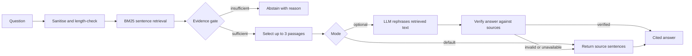

# Solution Design: Solstice Docs Q&A Assistant

## Problem and goal

Solstice admins need quick answers to questions already covered by product documentation. The key requirement is to
avoid guessing: when the documentation does not support an answer, the assistant should say so. I prioritize answer
precision over recall because an unsupported answer could lead an admin to take the wrong action.

## Assumptions

- The six supplied articles are the complete, trusted v1 corpus.
- Users are admins asking single-turn questions in English; no per-customer permissions are needed.
- A short answer grounded in cited documentation is useful; fluent phrasing is optional.
- The app should run without paid services, API keys, or non-standard Python packages.

## Approach

At startup, the app splits each article into sentences and builds an in-memory index. Sentence IDs (for example,
`D-03#5`) are used for retrieval and citations. Text is normalised with stop words, light stemming, and a small
data-driven synonym map. BM25 ranks matching sentences, with a small article-title bonus.

Before returning any answer, a deterministic gate checks for unknown question terms, weak matches, ambiguity between
articles, and insufficient weighted term coverage. When the gate rejects a question, the app abstains with a reason
and may suggest the closest article. For accepted questions, it selects the best sentence plus relevant neighboring
or complementary sentences, up to three, from the same article.

The default **extractive** mode returns those source sentences directly. Optional **LLM** mode sends only those
sentences and the question to a configured OpenAI-compatible chat endpoint (Ollama locally by default). The prompt
marks question and context as untrusted data. The app verifies citations, numbers, links, names, and unsupported
terms before showing a generated answer. Unverified output or service errors fall back to the extractive answer;
if the model explicitly declines, the app abstains. The model has no tools or access to other documents.

## Trade-offs

| Decision | Choice | Reason |
|---|---|---|
| Answer generation | Extractive by default; LLM optional | Verbatim text is predictable and runs without inference costs; generation is a quality enhancement, not a dependency. |
| Retrieval unit | Sentences | Preserves specific facts and procedures better than fixed-size chunks for this small corpus. |
| Retrieval method | BM25 plus synonyms | Simple, explainable, and dependency-free for six short articles; embeddings are a future option if lexical matching is insufficient. |
| Abstention | Layered evidence checks | A single similarity threshold can miss unsupported entities such as a plan or integration name. |
| Dependencies | Python standard library | Keeps setup and operation lightweight. |

## Validation and limitations

The labelled evaluation set contains 37 questions across direct, paraphrase, multi-part, out-of-scope, near-miss,
adversarial, and injection categories. Extractive mode passed **37/37**: no false answers among 19 unanswerable
questions and all 18 answerable questions answered correctly. The supplied examples pass **5/5**.

In a live test with local Ollama `llama3.2:3b`, LLM mode scored **34/37**: no false answers among the 19
unanswerable questions, but it answered only 15/18 answerable questions. It sometimes declined supported questions;
in other cases verification rejected extra wording and used the extractive fallback. This is an observed result for
one model and run, not a general accuracy claim. The evaluation set is small and was used to tune the retrieval
thresholds and synonyms, so the extractive score is optimistic.

Known v1 limits include lexical rather than semantic retrieval, English single-turn use, loading one local JSON
corpus at startup, and heuristic injection detection. The evaluation set is synthetic and needs validation against
held-out real admin questions before production use.

## With more time, data, and budget

First, collect and label real support questions, hold out a test set, and make zero false answers a release criterion.
Then consider hybrid lexical and embedding retrieval, document versioning and re-indexing, and retrieval filters based
on user permissions. For hosted models, use tenant-managed identity and secrets, TLS/private networking, data-retention
controls, PII-aware logging, monitoring, rate limits, and model/prompt versioning. A UI and support handoff can follow
once the single-turn answer quality is established.
